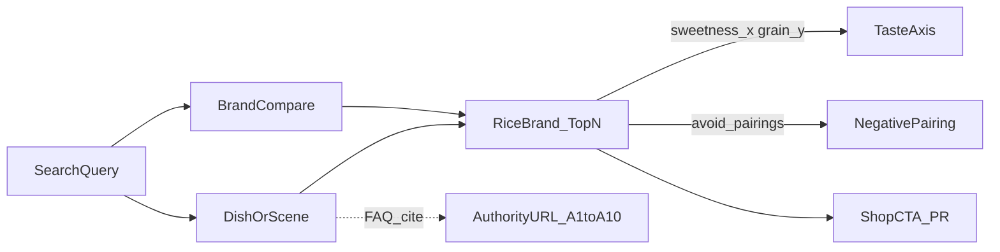

# SEO 意图与内容设计正本

正本。中文对 GAO；关键词 / 大纲骨格 / 引用文案用日语。
番号は [`VERSION`](../VERSION)。実装ロードマップの親は [20-growth-plan.md](./20-growth-plan.md)（Wave 2A / 2B）。編集特集の境界は [19-editorial-discovery.md](./19-editorial-discovery.md)。

**取数日（权威表）:** 2026-09-09

---

## 0. 一句话

不做「安い / 還元率」页。把检索意图接到 **甘み×粒感的一次データ + 向かない組み合わせ + 料理シーン**，让 Google / AI Overview 只能引用我们抄不走的表，而不是排行榜。

**本步只设计。** 不实现 `/pair` · `/compare` 路由。200 词是意图库存，不是 200 页。

---

## 1. 非目标

| 不做 | 理由 |
| --- | --- |
| ふるさと納税還元率・最安・ポイント比較页 | 对手战场；与 [13](./13-affiliate-compliance.md) 隔离冲突 |
| 200 个一一对应着陆页 / 106×106 比較 | 薄内容量产；20 规定 `/pair` ~30、`/compare` ~50 |
| LLM 批量生成日文正文 | 违反 `japanese-copy.mdc` 与 EEAT Experience |
| 改推薦式 / 座標軸含義 | 见 `semver.mdc`；需 GAO 明确同意 |
| 无 URL 的数字、自编案例 | 本正本禁止 |

---

## 2. 差异化硬门禁（Diff Gate）

页面 / 大纲入库前必须让爬虫与 AI 读出下面 **四条可引用资产** 中至少三条；缺则 **Fail → 立刻重写**：

1. **坐标排序依据写在页上**（甘み / 粒感与 Top N 怎么排出来的）
2. **`avoid_pairings`「この料理には向かない米」**（负面一次情報）
3. **人手リード**（非模板填空、非量产博客）
4. **比較表之后的直リンク CTA + `※PR`**（对照 [15](./15-disclosure-surfaces.md)）

**Kill 信号（出现即不得做主着陆）:** 還元率、最安、ポイント還元、ふるさと納税ランキング（价格轴）。

---

## 3. 漏斗 × 查询类型

| 漏斗段 | 问题型 (Q) | 对比型 (C) | 场景型 (S) |
| --- | --- | --- | --- |
| 認知 | 〜とは / どう選ぶ | 概念差（甘み vs 粒感） | 初めての白米 |
| 比較 | どちらが向く / 向かない | 銘柄 vs 銘柄 | カレー向き vs 寿司向き |
| シーン決定 | 〜に合う米は | Top 表内比較 | 弁当 / 丼 / 鍋 / 季節 |
| 購入直前 | お店で探す / 注意点 | 表後の最終比較 | 贈答・一人暮らし |

---

## 4. 权威 URL 登记表（生成锚点）

只收录 2026-09-09 能打开的原文。**数字只从「可引用字段」摘；摘不到就不写进大纲正文。**

| ID | 机构 | 标题 / 资料 | URL | 可引用字段（已核实） | 备注 |
| --- | --- | --- | --- | --- | --- |
| A1 | 農林水産省 | 米に関するマンスリーレポート（索引） | https://www.maff.go.jp/j/seisan/keikaku/soukatu/mr.html | 每月价格・需给数据入口；引用时链到当月刊 PDF | 索引页已核实 |
| A2 | 農林水産省 | 米に関するマンスリーレポート（令和7年9月号）公表 | https://www.maff.go.jp/j/press/nousan/kikaku/250919.html | 公表事実（令和7年9月19日）。具体数値は添付 PDF | プレスは入口；数値は PDF |
| A3 | 一般財団法人日本穀物検定協会 | 米の食味ランキング（地域選択） | https://www.kokken.or.jp/ranking_area.html | ランキングの定義・「流通するすべての米を評価しているものではない」旨 | **権威の引用先**。特Aを自社売りにしない |
| A4 | 日本穀物検定協会 | 令和7年産米の食味ランキングについて（PDF） | https://kokken.or.jp/data/R7_shokumi_next.pdf | 公表日: 令和8年2月27日。官能6項目。対象は道府県選出の産地品種 | 概要の件数は A5 |
| A5 | 日本穀物検定協会 | 米の食味ランキングの概要（PDF） | https://www.kokken.or.jp/data/rank_gaiyou.pdf | 令和7年産: 対象144。特A=43、A=71、A'=30。B/B'=0 | 件数はこの PDF から |
| A6 | ＪＡ全農 | 「米流通に関するファクトブック」公開プレス | https://www.zennoh.or.jp/press/release/2025/105622.html | 公開日: 7月9日（プレス記載）。生産・流通・価格の仕組みの解説資料 | 数値を使うなら PDF 本文を再確認 |
| A7 | ＪＡ全農 | 米流通に関するファクトブック（PDF） | https://www.zennoh.or.jp/ricefactbook/pdf/factbook.pdf | 流通構造・備蓄米制度などの基礎説明 | 引用前に該当頁を開く |
| A8 | 公益社団法人米穀安定供給確保支援機構 | 米ネット（公式トップ） | https://www.komenet.jp/ | 機構の役割・情報提供窓口 | 統計は下位ページへ |
| A9 | 農林水産省 → 米穀機構 | 米のコスト指標（省側案内） | https://www.maff.go.jp/j/syouan/keikaku/soukatu/komecost.html | 令和8年4月7日にコスト指標公表の案内。機構 HP への外部リンク | 数値は機構側ページを正本に |
| A10 | 日本経済新聞 | 25年産コメ需要見通しの報道（農水試算を引用） | https://www.nikkei.com/article/DGXZQOUA195KR0Z10C26A3000000/ | 報道上の農水試算: 需要 691万〜704万トン 等 | **二次情報**。FAQ で使うなら「報道によれば」+ 可能なら A1 一次に戻す |

### 引用纪律

- 食味ランキング（A3–A5）= **権威の背景**。页面卖点永远是我们的坐标与向かない，不是「特Aだから買え」。
- 需给・価格（A1/A2/A10）= FAQ「なぜ今、味で選ぶ話が増えたか」的宏观语境；**不**做价格比较表。
- ファクトブック（A6/A7）= 流通结构说明的外链，不抄图不改数字。

---

## 5. 意图库存（200）

类型: **Q**=问题型 · **C**=对比型 · **S**=场景型。  
`gate=Kill` 不分配落地页（仅作反例）。

**集計:** 全 200 条 · Pass 190 · Kill 10 · Q 74 / C 55 / S 71

| # | キーワード | 型 | 漏斗 | cluster | primary_url | gate |
| --- | --- | --- | --- | --- | --- | --- |
| 1 | ふるさと納税 米 還元率 ランキング | Q | 認知 | `KILL` | `—` | Kill |
| 2 | 米 最安 通販 | Q | 購入直前 | `KILL` | `—` | Kill |
| 3 | コシヒカリ 安い どこ | Q | 購入直前 | `KILL` | `—` | Kill |
| 4 | ふるさと納税 米 コスパ | C | 比較 | `KILL` | `—` | Kill |
| 5 | 米 還元率 比較 | C | 比較 | `KILL` | `—` | Kill |
| 6 | 楽天 米 ポイント還元 | S | 購入直前 | `KILL` | `—` | Kill |
| 7 | ふるさと納税 米 おすすめ 還元 | S | シーン決定 | `KILL` | `—` | Kill |
| 8 | 業務用米 最安 | Q | 購入直前 | `KILL` | `—` | Kill |
| 9 | 米 価格 ランキング 安い順 | C | 比較 | `KILL` | `—` | Kill |
| 10 | ふるさと 米 gあたり還元 | Q | 認知 | `KILL` | `—` | Kill |
| 11 | コシヒカリ と つや姫 の違い | C | 比較 | `compare:koshihikari-vs-tsuyahime` | `/compare/koshihikari-vs-tsuyahime` | Pass |
| 12 | コシヒカリ つや姫 どちら 味 | C | 比較 | `compare:koshihikari-vs-tsuyahime` | `/compare/koshihikari-vs-tsuyahime` | Pass |
| 13 | コシヒカリ と つや姫 どっちが甘い | C | 比較 | `compare:koshihikari-vs-tsuyahime` | `/compare/koshihikari-vs-tsuyahime` | Pass |
| 14 | コシヒカリ vs つや姫 粒感 | C | 比較 | `compare:koshihikari-vs-tsuyahime` | `/compare/koshihikari-vs-tsuyahime` | Pass |
| 15 | コシヒカリ つや姫 料理向き | C | シーン決定 | `compare:koshihikari-vs-tsuyahime` | `/compare/koshihikari-vs-tsuyahime` | Pass |
| 16 | コシヒカリ と つや姫 向かない 料理 | C | 比較 | `compare:koshihikari-vs-tsuyahime` | `/compare/koshihikari-vs-tsuyahime` | Pass |
| 17 | つや姫 は コシヒカリ より 粘る？ | Q | 比較 | `compare:koshihikari-vs-tsuyahime` | `/compare/koshihikari-vs-tsuyahime` | Pass |
| 18 | コシヒカリ つや姫 食べ比べ 軸 | S | 比較 | `compare:koshihikari-vs-tsuyahime` | `/compare/koshihikari-vs-tsuyahime` | Pass |
| 19 | コシヒカリ と ゆめぴりか の違い | C | 比較 | `compare:koshihikari-vs-yume` | `/compare/koshihikari-vs-yume` | Pass |
| 20 | コシヒカリ ゆめぴりか どちら 味 | C | 比較 | `compare:koshihikari-vs-yume` | `/compare/koshihikari-vs-yume` | Pass |
| 21 | コシヒカリ と ゆめぴりか どっちが甘い | C | 比較 | `compare:koshihikari-vs-yume` | `/compare/koshihikari-vs-yume` | Pass |
| 22 | コシヒカリ vs ゆめぴりか 粒感 | C | 比較 | `compare:koshihikari-vs-yume` | `/compare/koshihikari-vs-yume` | Pass |
| 23 | コシヒカリ ゆめぴりか 料理向き | C | シーン決定 | `compare:koshihikari-vs-yume` | `/compare/koshihikari-vs-yume` | Pass |
| 24 | コシヒカリ と ゆめぴりか 向かない 料理 | C | 比較 | `compare:koshihikari-vs-yume` | `/compare/koshihikari-vs-yume` | Pass |
| 25 | ゆめぴりか は コシヒカリ より 粘る？ | Q | 比較 | `compare:koshihikari-vs-yume` | `/compare/koshihikari-vs-yume` | Pass |
| 26 | コシヒカリ ゆめぴりか 食べ比べ 軸 | S | 比較 | `compare:koshihikari-vs-yume` | `/compare/koshihikari-vs-yume` | Pass |
| 27 | ササニシキ と コシヒカリ の違い | C | 比較 | `compare:sasanishiki-vs-koshihikari` | `/compare/sasanishiki-vs-koshihikari` | Pass |
| 28 | ササニシキ コシヒカリ どちら 味 | C | 比較 | `compare:sasanishiki-vs-koshihikari` | `/compare/sasanishiki-vs-koshihikari` | Pass |
| 29 | ササニシキ と コシヒカリ どっちが甘い | C | 比較 | `compare:sasanishiki-vs-koshihikari` | `/compare/sasanishiki-vs-koshihikari` | Pass |
| 30 | ササニシキ vs コシヒカリ 粒感 | C | 比較 | `compare:sasanishiki-vs-koshihikari` | `/compare/sasanishiki-vs-koshihikari` | Pass |
| 31 | ササニシキ コシヒカリ 料理向き | C | シーン決定 | `compare:sasanishiki-vs-koshihikari` | `/compare/sasanishiki-vs-koshihikari` | Pass |
| 32 | ササニシキ と コシヒカリ 向かない 料理 | C | 比較 | `compare:sasanishiki-vs-koshihikari` | `/compare/sasanishiki-vs-koshihikari` | Pass |
| 33 | コシヒカリ は ササニシキ より 粘る？ | Q | 比較 | `compare:sasanishiki-vs-koshihikari` | `/compare/sasanishiki-vs-koshihikari` | Pass |
| 34 | ササニシキ コシヒカリ 食べ比べ 軸 | S | 比較 | `compare:sasanishiki-vs-koshihikari` | `/compare/sasanishiki-vs-koshihikari` | Pass |
| 35 | あきたこまち と ひとめぼれ の違い | C | 比較 | `compare:akitakomachi-vs-hitomebore` | `/compare/akitakomachi-vs-hitomebore` | Pass |
| 36 | あきたこまち ひとめぼれ どちら 味 | C | 比較 | `compare:akitakomachi-vs-hitomebore` | `/compare/akitakomachi-vs-hitomebore` | Pass |
| 37 | あきたこまち と ひとめぼれ どっちが甘い | C | 比較 | `compare:akitakomachi-vs-hitomebore` | `/compare/akitakomachi-vs-hitomebore` | Pass |
| 38 | あきたこまち vs ひとめぼれ 粒感 | C | 比較 | `compare:akitakomachi-vs-hitomebore` | `/compare/akitakomachi-vs-hitomebore` | Pass |
| 39 | あきたこまち ひとめぼれ 料理向き | C | シーン決定 | `compare:akitakomachi-vs-hitomebore` | `/compare/akitakomachi-vs-hitomebore` | Pass |
| 40 | あきたこまち と ひとめぼれ 向かない 料理 | C | 比較 | `compare:akitakomachi-vs-hitomebore` | `/compare/akitakomachi-vs-hitomebore` | Pass |
| 41 | ひとめぼれ は あきたこまち より 粘る？ | Q | 比較 | `compare:akitakomachi-vs-hitomebore` | `/compare/akitakomachi-vs-hitomebore` | Pass |
| 42 | あきたこまち ひとめぼれ 食べ比べ 軸 | S | 比較 | `compare:akitakomachi-vs-hitomebore` | `/compare/akitakomachi-vs-hitomebore` | Pass |
| 43 | つや姫 と ゆめぴりか の違い | C | 比較 | `compare:tsuyahime-vs-yume` | `/compare/tsuyahime-vs-yume` | Pass |
| 44 | つや姫 ゆめぴりか どちら 味 | C | 比較 | `compare:tsuyahime-vs-yume` | `/compare/tsuyahime-vs-yume` | Pass |
| 45 | つや姫 と ゆめぴりか どっちが甘い | C | 比較 | `compare:tsuyahime-vs-yume` | `/compare/tsuyahime-vs-yume` | Pass |
| 46 | つや姫 vs ゆめぴりか 粒感 | C | 比較 | `compare:tsuyahime-vs-yume` | `/compare/tsuyahime-vs-yume` | Pass |
| 47 | つや姫 ゆめぴりか 料理向き | C | シーン決定 | `compare:tsuyahime-vs-yume` | `/compare/tsuyahime-vs-yume` | Pass |
| 48 | つや姫 と ゆめぴりか 向かない 料理 | C | 比較 | `compare:tsuyahime-vs-yume` | `/compare/tsuyahime-vs-yume` | Pass |
| 49 | ゆめぴりか は つや姫 より 粘る？ | Q | 比較 | `compare:tsuyahime-vs-yume` | `/compare/tsuyahime-vs-yume` | Pass |
| 50 | つや姫 ゆめぴりか 食べ比べ 軸 | S | 比較 | `compare:tsuyahime-vs-yume` | `/compare/tsuyahime-vs-yume` | Pass |
| 51 | ミルキークイーン と コシヒカリ の違い | C | 比較 | `compare:milky-vs-koshihikari` | `/compare/milky-vs-koshihikari` | Pass |
| 52 | ミルキークイーン コシヒカリ どちら 味 | C | 比較 | `compare:milky-vs-koshihikari` | `/compare/milky-vs-koshihikari` | Pass |
| 53 | ミルキークイーン と コシヒカリ どっちが甘い | C | 比較 | `compare:milky-vs-koshihikari` | `/compare/milky-vs-koshihikari` | Pass |
| 54 | ミルキークイーン vs コシヒカリ 粒感 | C | 比較 | `compare:milky-vs-koshihikari` | `/compare/milky-vs-koshihikari` | Pass |
| 55 | ミルキークイーン コシヒカリ 料理向き | C | シーン決定 | `compare:milky-vs-koshihikari` | `/compare/milky-vs-koshihikari` | Pass |
| 56 | ミルキークイーン と コシヒカリ 向かない 料理 | C | 比較 | `compare:milky-vs-koshihikari` | `/compare/milky-vs-koshihikari` | Pass |
| 57 | コシヒカリ は ミルキークイーン より 粘る？ | Q | 比較 | `compare:milky-vs-koshihikari` | `/compare/milky-vs-koshihikari` | Pass |
| 58 | ミルキークイーン コシヒカリ 食べ比べ 軸 | S | 比較 | `compare:milky-vs-koshihikari` | `/compare/milky-vs-koshihikari` | Pass |
| 59 | ゆめぴりか と ななつぼし の違い | C | 比較 | `compare:yume-vs-nanatsuboshi` | `/compare/yume-vs-nanatsuboshi` | Pass |
| 60 | ゆめぴりか ななつぼし どちら 味 | C | 比較 | `compare:yume-vs-nanatsuboshi` | `/compare/yume-vs-nanatsuboshi` | Pass |
| 61 | ゆめぴりか と ななつぼし どっちが甘い | C | 比較 | `compare:yume-vs-nanatsuboshi` | `/compare/yume-vs-nanatsuboshi` | Pass |
| 62 | ゆめぴりか vs ななつぼし 粒感 | C | 比較 | `compare:yume-vs-nanatsuboshi` | `/compare/yume-vs-nanatsuboshi` | Pass |
| 63 | ゆめぴりか ななつぼし 料理向き | C | シーン決定 | `compare:yume-vs-nanatsuboshi` | `/compare/yume-vs-nanatsuboshi` | Pass |
| 64 | ゆめぴりか と ななつぼし 向かない 料理 | C | 比較 | `compare:yume-vs-nanatsuboshi` | `/compare/yume-vs-nanatsuboshi` | Pass |
| 65 | ななつぼし は ゆめぴりか より 粘る？ | Q | 比較 | `compare:yume-vs-nanatsuboshi` | `/compare/yume-vs-nanatsuboshi` | Pass |
| 66 | ゆめぴりか ななつぼし 食べ比べ 軸 | S | 比較 | `compare:yume-vs-nanatsuboshi` | `/compare/yume-vs-nanatsuboshi` | Pass |
| 67 | ひとめぼれ と はえぬき の違い | C | 比較 | `compare:hitomebore-vs-haenuki` | `/compare/hitomebore-vs-haenuki` | Pass |
| 68 | ひとめぼれ はえぬき どちら 味 | C | 比較 | `compare:hitomebore-vs-haenuki` | `/compare/hitomebore-vs-haenuki` | Pass |
| 69 | ひとめぼれ と はえぬき どっちが甘い | C | 比較 | `compare:hitomebore-vs-haenuki` | `/compare/hitomebore-vs-haenuki` | Pass |
| 70 | ひとめぼれ vs はえぬき 粒感 | C | 比較 | `compare:hitomebore-vs-haenuki` | `/compare/hitomebore-vs-haenuki` | Pass |
| 71 | ひとめぼれ はえぬき 料理向き | C | シーン決定 | `compare:hitomebore-vs-haenuki` | `/compare/hitomebore-vs-haenuki` | Pass |
| 72 | ひとめぼれ と はえぬき 向かない 料理 | C | 比較 | `compare:hitomebore-vs-haenuki` | `/compare/hitomebore-vs-haenuki` | Pass |
| 73 | はえぬき は ひとめぼれ より 粘る？ | Q | 比較 | `compare:hitomebore-vs-haenuki` | `/compare/hitomebore-vs-haenuki` | Pass |
| 74 | ひとめぼれ はえぬき 食べ比べ 軸 | S | 比較 | `compare:hitomebore-vs-haenuki` | `/compare/hitomebore-vs-haenuki` | Pass |
| 75 | 新米 どう選ぶ 味 | Q | 認知 | `pair:gift` | `/pair/gift` | Pass |
| 76 | 初めての 白米 銘柄 | Q | 認知 | `pair:tamagokake` | `/pair/tamagokake` | Pass |
| 77 | 一人暮らし 米 味で選ぶ | S | シーン決定 | `pair:onigiri` | `/pair/onigiri` | Pass |
| 78 | 新生活 米 選び方 甘み | S | シーン決定 | `pair:bento` | `/pair/bento` | Pass |
| 79 | 夏 白米 さっぱり | S | シーン決定 | `pair:sashimi` | `/pair/sashimi` | Pass |
| 80 | 秋 新米 食べ比べ 軸 | S | シーン決定 | `pair:gift` | `/pair/gift` | Pass |
| 81 | 冬 鍋 米 粘り | S | シーン決定 | `pair:nabe` | `/pair/nabe` | Pass |
| 82 | 春 弁当 米 冷めて | S | シーン決定 | `pair:bento_cold` | `/pair/bento_cold` | Pass |
| 83 | お歳暮 米 味の説明 | S | 購入直前 | `pair:gift` | `/pair/gift` | Pass |
| 84 | 出産内祝い 米 銘柄 差 | S | 購入直前 | `pair:gift` | `/pair/gift` | Pass |
| 85 | 甘みの強い 米 とは | Q | 認知 | `lib:axis` | `/library` | Pass |
| 86 | 粒感 強い 米 とは | Q | 認知 | `lib:axis` | `/library` | Pass |
| 87 | 粘り 少ない 米 料理 | Q | シーン決定 | `pair:chahan` | `/pair/chahan` | Pass |
| 88 | あっさり 米 刺身 | Q | シーン決定 | `pair:sashimi` | `/pair/sashimi` | Pass |
| 89 | もっちり 米 カレー | Q | シーン決定 | `pair:curry` | `/pair/curry` | Pass |
| 90 | 侍米師 相談 とは | Q | 認知 | `lib:consult` | `/` | Pass |
| 91 | 味わい地図 使い方 | Q | 認知 | `lib:matrix` | `/` | Pass |
| 92 | 米 銘柄 違い 甘み | C | 認知 | `lib:axis` | `/library` | Pass |
| 93 | 甘みと粒感 どっちを見る | C | 認知 | `lib:axis` | `/library` | Pass |
| 94 | 特A と 味わい座標 の違い | C | 認知 | `lib:axis` | `/library` | Pass |
| 95 | カレー向き 米 お店で探す | S | 購入直前 | `pair:curry` | `/pair/curry` | Pass |
| 96 | 刺身向き 米 通販 直リンク | S | 購入直前 | `pair:sashimi` | `/pair/sashimi` | Pass |
| 97 | 比較表のあと 買う | Q | 購入直前 | `pair:bento` | `/pair/bento` | Pass |
| 98 | 銘柄ページ お店で探す | Q | 購入直前 | `lib:brand` | `/library` | Pass |
| 99 | つや姫 味の説明 から買う | S | 購入直前 | `compare:koshihikari-vs-tsuyahime` | `/compare/koshihikari-vs-tsuyahime` | Pass |
| 100 | カレーライス に合う 米 | Q | シーン決定 | `pair:curry` | `/pair/curry` | Pass |
| 101 | カレーライス に 向かない 米 | Q | 比較 | `pair:curry` | `/pair/curry` | Pass |
| 102 | カレーライス の日の 白米 | S | シーン決定 | `pair:curry` | `/pair/curry` | Pass |
| 103 | カレー に合う 甘み 粒感 | S | 比較 | `pair:curry` | `/pair/curry` | Pass |
| 104 | 刺身 に合う 米 | Q | シーン決定 | `pair:sashimi` | `/pair/sashimi` | Pass |
| 105 | 刺身 に 向かない 米 | Q | 比較 | `pair:sashimi` | `/pair/sashimi` | Pass |
| 106 | 刺身 の日の 白米 | S | シーン決定 | `pair:sashimi` | `/pair/sashimi` | Pass |
| 107 | 刺身 に合う 甘み 粒感 | S | 比較 | `pair:sashimi` | `/pair/sashimi` | Pass |
| 108 | お弁当 に合う 米 | Q | シーン決定 | `pair:bento` | `/pair/bento` | Pass |
| 109 | お弁当 に 向かない 米 | Q | 比較 | `pair:bento` | `/pair/bento` | Pass |
| 110 | お弁当 の日の 白米 | S | シーン決定 | `pair:bento` | `/pair/bento` | Pass |
| 111 | 弁当 に合う 甘み 粒感 | S | 比較 | `pair:bento` | `/pair/bento` | Pass |
| 112 | 鍋料理 に合う 米 | Q | シーン決定 | `pair:nabe` | `/pair/nabe` | Pass |
| 113 | 鍋料理 に 向かない 米 | Q | 比較 | `pair:nabe` | `/pair/nabe` | Pass |
| 114 | 鍋料理 の日の 白米 | S | シーン決定 | `pair:nabe` | `/pair/nabe` | Pass |
| 115 | 鍋 に合う 甘み 粒感 | S | 比較 | `pair:nabe` | `/pair/nabe` | Pass |
| 116 | 丼もの に合う 米 | Q | シーン決定 | `pair:donburi` | `/pair/donburi` | Pass |
| 117 | 丼もの に 向かない 米 | Q | 比較 | `pair:donburi` | `/pair/donburi` | Pass |
| 118 | 丼もの の日の 白米 | S | シーン決定 | `pair:donburi` | `/pair/donburi` | Pass |
| 119 | 丼 に合う 甘み 粒感 | S | 比較 | `pair:donburi` | `/pair/donburi` | Pass |
| 120 | チャーハン に合う 米 | Q | シーン決定 | `pair:chahan` | `/pair/chahan` | Pass |
| 121 | チャーハン に 向かない 米 | Q | 比較 | `pair:chahan` | `/pair/chahan` | Pass |
| 122 | チャーハン の日の 白米 | S | シーン決定 | `pair:chahan` | `/pair/chahan` | Pass |
| 123 | 炒飯 に合う 甘み 粒感 | S | 比較 | `pair:chahan` | `/pair/chahan` | Pass |
| 124 | お寿司 に合う 米 | Q | シーン決定 | `pair:sushi` | `/pair/sushi` | Pass |
| 125 | お寿司 に 向かない 米 | Q | 比較 | `pair:sushi` | `/pair/sushi` | Pass |
| 126 | お寿司 の日の 白米 | S | シーン決定 | `pair:sushi` | `/pair/sushi` | Pass |
| 127 | 寿司 に合う 甘み 粒感 | S | 比較 | `pair:sushi` | `/pair/sushi` | Pass |
| 128 | 唐揚げ に合う 米 | Q | シーン決定 | `pair:karaage` | `/pair/karaage` | Pass |
| 129 | 唐揚げ に 向かない 米 | Q | 比較 | `pair:karaage` | `/pair/karaage` | Pass |
| 130 | 唐揚げ の日の 白米 | S | シーン決定 | `pair:karaage` | `/pair/karaage` | Pass |
| 131 | 唐揚げ に合う 甘み 粒感 | S | 比較 | `pair:karaage` | `/pair/karaage` | Pass |
| 132 | おにぎり に合う 米 | Q | シーン決定 | `pair:onigiri` | `/pair/onigiri` | Pass |
| 133 | おにぎり に 向かない 米 | Q | 比較 | `pair:onigiri` | `/pair/onigiri` | Pass |
| 134 | おにぎり の日の 白米 | S | シーン決定 | `pair:onigiri` | `/pair/onigiri` | Pass |
| 135 | おにぎり に合う 甘み 粒感 | S | 比較 | `pair:onigiri` | `/pair/onigiri` | Pass |
| 136 | おかゆ に合う 米 | Q | シーン決定 | `pair:okayu` | `/pair/okayu` | Pass |
| 137 | おかゆ に 向かない 米 | Q | 比較 | `pair:okayu` | `/pair/okayu` | Pass |
| 138 | おかゆ の日の 白米 | S | シーン決定 | `pair:okayu` | `/pair/okayu` | Pass |
| 139 | おかゆ に合う 甘み 粒感 | S | 比較 | `pair:okayu` | `/pair/okayu` | Pass |
| 140 | 牛丼 に合う 米 | Q | シーン決定 | `pair:gyudon` | `/pair/gyudon` | Pass |
| 141 | 牛丼 に 向かない 米 | Q | 比較 | `pair:gyudon` | `/pair/gyudon` | Pass |
| 142 | 牛丼 の日の 白米 | S | シーン決定 | `pair:gyudon` | `/pair/gyudon` | Pass |
| 143 | 牛丼 に合う 甘み 粒感 | S | 比較 | `pair:gyudon` | `/pair/gyudon` | Pass |
| 144 | 親子丼 に合う 米 | Q | シーン決定 | `pair:oyakodon` | `/pair/oyakodon` | Pass |
| 145 | 親子丼 に 向かない 米 | Q | 比較 | `pair:oyakodon` | `/pair/oyakodon` | Pass |
| 146 | 親子丼 の日の 白米 | S | シーン決定 | `pair:oyakodon` | `/pair/oyakodon` | Pass |
| 147 | 親子丼 に合う 甘み 粒感 | S | 比較 | `pair:oyakodon` | `/pair/oyakodon` | Pass |
| 148 | 天丼 に合う 米 | Q | シーン決定 | `pair:tendon` | `/pair/tendon` | Pass |
| 149 | 天丼 に 向かない 米 | Q | 比較 | `pair:tendon` | `/pair/tendon` | Pass |
| 150 | 天丼 の日の 白米 | S | シーン決定 | `pair:tendon` | `/pair/tendon` | Pass |
| 151 | 天丼 に合う 甘み 粒感 | S | 比較 | `pair:tendon` | `/pair/tendon` | Pass |
| 152 | 海鮮丼 に合う 米 | Q | シーン決定 | `pair:kaisendon` | `/pair/kaisendon` | Pass |
| 153 | 海鮮丼 に 向かない 米 | Q | 比較 | `pair:kaisendon` | `/pair/kaisendon` | Pass |
| 154 | 海鮮丼 の日の 白米 | S | シーン決定 | `pair:kaisendon` | `/pair/kaisendon` | Pass |
| 155 | 海鮮丼 に合う 甘み 粒感 | S | 比較 | `pair:kaisendon` | `/pair/kaisendon` | Pass |
| 156 | ステーキ に合う 米 | Q | シーン決定 | `pair:steak` | `/pair/steak` | Pass |
| 157 | ステーキ に 向かない 米 | Q | 比較 | `pair:steak` | `/pair/steak` | Pass |
| 158 | ステーキ の日の 白米 | S | シーン決定 | `pair:steak` | `/pair/steak` | Pass |
| 159 | ステーキ に合う 甘み 粒感 | S | 比較 | `pair:steak` | `/pair/steak` | Pass |
| 160 | 焼肉 に合う 米 | Q | シーン決定 | `pair:yakiniku` | `/pair/yakiniku` | Pass |
| 161 | 焼肉 に 向かない 米 | Q | 比較 | `pair:yakiniku` | `/pair/yakiniku` | Pass |
| 162 | 焼肉 の日の 白米 | S | シーン決定 | `pair:yakiniku` | `/pair/yakiniku` | Pass |
| 163 | 焼肉 に合う 甘み 粒感 | S | 比較 | `pair:yakiniku` | `/pair/yakiniku` | Pass |
| 164 | すき焼き に合う 米 | Q | シーン決定 | `pair:sukiyaki` | `/pair/sukiyaki` | Pass |
| 165 | すき焼き に 向かない 米 | Q | 比較 | `pair:sukiyaki` | `/pair/sukiyaki` | Pass |
| 166 | すき焼き の日の 白米 | S | シーン決定 | `pair:sukiyaki` | `/pair/sukiyaki` | Pass |
| 167 | すき焼き に合う 甘み 粒感 | S | 比較 | `pair:sukiyaki` | `/pair/sukiyaki` | Pass |
| 168 | 焼き魚 に合う 米 | Q | シーン決定 | `pair:yakizakana` | `/pair/yakizakana` | Pass |
| 169 | 焼き魚 に 向かない 米 | Q | 比較 | `pair:yakizakana` | `/pair/yakizakana` | Pass |
| 170 | 焼き魚 の日の 白米 | S | シーン決定 | `pair:yakizakana` | `/pair/yakizakana` | Pass |
| 171 | 焼き魚 に合う 甘み 粒感 | S | 比較 | `pair:yakizakana` | `/pair/yakizakana` | Pass |
| 172 | 納豆 に合う 米 | Q | シーン決定 | `pair:natto` | `/pair/natto` | Pass |
| 173 | 納豆 に 向かない 米 | Q | 比較 | `pair:natto` | `/pair/natto` | Pass |
| 174 | 納豆 の日の 白米 | S | シーン決定 | `pair:natto` | `/pair/natto` | Pass |
| 175 | 納豆 に合う 甘み 粒感 | S | 比較 | `pair:natto` | `/pair/natto` | Pass |
| 176 | 茶漬け に合う 米 | Q | シーン決定 | `pair:ochazuke` | `/pair/ochazuke` | Pass |
| 177 | 茶漬け に 向かない 米 | Q | 比較 | `pair:ochazuke` | `/pair/ochazuke` | Pass |
| 178 | 茶漬け の日の 白米 | S | シーン決定 | `pair:ochazuke` | `/pair/ochazuke` | Pass |
| 179 | 茶漬け に合う 甘み 粒感 | S | 比較 | `pair:ochazuke` | `/pair/ochazuke` | Pass |
| 180 | 卵かけご飯 に合う 米 | Q | シーン決定 | `pair:tamagokake` | `/pair/tamagokake` | Pass |
| 181 | 卵かけご飯 に 向かない 米 | Q | 比較 | `pair:tamagokake` | `/pair/tamagokake` | Pass |
| 182 | 卵かけご飯 の日の 白米 | S | シーン決定 | `pair:tamagokake` | `/pair/tamagokake` | Pass |
| 183 | 卵かけご飯 に合う 甘み 粒感 | S | 比較 | `pair:tamagokake` | `/pair/tamagokake` | Pass |
| 184 | リゾット に合う 米 | Q | シーン決定 | `pair:risotto` | `/pair/risotto` | Pass |
| 185 | リゾット に 向かない 米 | Q | 比較 | `pair:risotto` | `/pair/risotto` | Pass |
| 186 | リゾット の日の 白米 | S | シーン決定 | `pair:risotto` | `/pair/risotto` | Pass |
| 187 | リゾット に合う 甘み 粒感 | S | 比較 | `pair:risotto` | `/pair/risotto` | Pass |
| 188 | パエリア に合う 米 | Q | シーン決定 | `pair:paella` | `/pair/paella` | Pass |
| 189 | パエリア に 向かない 米 | Q | 比較 | `pair:paella` | `/pair/paella` | Pass |
| 190 | パエリア の日の 白米 | S | シーン決定 | `pair:paella` | `/pair/paella` | Pass |
| 191 | パエリア に合う 甘み 粒感 | S | 比較 | `pair:paella` | `/pair/paella` | Pass |
| 192 | 冷めても に合う 甘み 粒感 | S | 比較 | `pair:bento_cold` | `/pair/bento_cold` | Pass |
| 193 | 贈答 に合う 米 | Q | シーン決定 | `pair:gift` | `/pair/gift` | Pass |
| 194 | 贈答 に 向かない 米 | Q | 比較 | `pair:gift` | `/pair/gift` | Pass |
| 195 | 贈答 の日の 白米 | S | シーン決定 | `pair:gift` | `/pair/gift` | Pass |
| 196 | 贈答 に合う 甘み 粒感 | S | 比較 | `pair:gift` | `/pair/gift` | Pass |
| 197 | 丼もの タレ 強いとき 米 | Q | シーン決定 | `pair:donburi` | `/pair/donburi` | Pass |
| 198 | カレー ソースと米のバランス | C | シーン決定 | `pair:curry` | `/pair/curry` | Pass |
| 199 | 刺身 米は主役ではない | Q | シーン決定 | `pair:sashimi` | `/pair/sashimi` | Pass |
| 200 | 弁当 昼まで粒が残る米 | S | シーン決定 | `pair:bento` | `/pair/bento` | Pass |

---

## 6. 聚类 → URL 地图

多词一页。首发以 `/pair` 为主（Wave 2A）；`/compare` 进 Wave 2B。

### 6.1 `/pair`（Wave 2A）

| URL | 代表料理 | 覆盖 Pass 词数 | 备注 |
| --- | --- | --- | --- |
| `/pair/curry` | カレーライス（カレー） | 7 | Wave 2A 候補 |
| `/pair/sashimi` | 刺身（刺身） | 8 | Wave 2A 候補 |
| `/pair/bento` | お弁当（弁当） | 7 | Wave 2A 候補 |
| `/pair/nabe` | 鍋料理（鍋） | 5 | Wave 2A 候補 |
| `/pair/donburi` | 丼もの（丼） | 5 | Wave 2A 候補 |
| `/pair/chahan` | チャーハン（炒飯） | 5 | Wave 2A 候補 |
| `/pair/sushi` | お寿司（寿司） | 4 | Wave 2A 候補 |
| `/pair/karaage` | 唐揚げ（唐揚げ） | 4 | Wave 2A 候補 |
| `/pair/onigiri` | おにぎり（おにぎり） | 5 | Wave 2A 候補 |
| `/pair/okayu` | おかゆ（おかゆ） | 4 | Wave 2A 候補 |
| `/pair/gyudon` | 牛丼（牛丼） | 4 | Wave 2A 候補 |
| `/pair/oyakodon` | 親子丼（親子丼） | 4 | Wave 2A 候補 |
| `/pair/tendon` | 天丼（天丼） | 4 | Wave 2A 候補 |
| `/pair/kaisendon` | 海鮮丼（海鮮丼） | 4 | Wave 2A 候補 |
| `/pair/steak` | ステーキ（ステーキ） | 4 | Wave 2A 候補 |
| `/pair/yakiniku` | 焼肉（焼肉） | 4 | Wave 2A 候補 |
| `/pair/sukiyaki` | すき焼き（すき焼き） | 4 | Wave 2A 候補 |
| `/pair/yakizakana` | 焼き魚（焼き魚） | 4 | Wave 2A 候補 |
| `/pair/natto` | 納豆（納豆） | 4 | Wave 2A 候補 |
| `/pair/ochazuke` | 茶漬け（茶漬け） | 4 | Wave 2A 候補 |
| `/pair/tamagokake` | 卵かけご飯（卵かけご飯） | 5 | Wave 2A 候補 |
| `/pair/risotto` | リゾット（リゾット） | 4 | Wave 2A 候補 |
| `/pair/paella` | パエリア（パエリア） | 4 | Wave 2A 候補 |
| `/pair/bento_cold` | お弁当（冷めても） | 2 | Wave 2A 候補 |
| `/pair/gift` | 贈答（贈答） | 8 | Wave 2A 候補 |

**首发建议（人手 20〜25 本から先に閉じる）:**  
`curry` · `sashimi` · `bento` · `bento_cold` · `nabe` · `donburi` · `chahan` · `sushi` · `karaage` · `onigiri` · `gyudon` · `oyakodon` · `kaisendon` · `yakizakana` · `natto` · `tamagokake` · `sukiyaki` · `yakiniku` · `ochazuke` · `gift` · `steak` · `tendon` · `okayu` · `risotto` · `paella`

### 6.2 `/compare`（Wave 2B）

| URL | 対 | 覆盖 Pass 词数 | 波次 |
| --- | --- | --- | --- |
| `/compare/koshihikari-vs-tsuyahime` | コシヒカリ vs つや姫 | 9 | Wave 2B |
| `/compare/koshihikari-vs-yume` | コシヒカリ vs ゆめぴりか | 8 | Wave 2B |
| `/compare/sasanishiki-vs-koshihikari` | ササニシキ vs コシヒカリ | 8 | Wave 2B |
| `/compare/akitakomachi-vs-hitomebore` | あきたこまち vs ひとめぼれ | 8 | Wave 2B |
| `/compare/tsuyahime-vs-yume` | つや姫 vs ゆめぴりか | 8 | Wave 2B |
| `/compare/milky-vs-koshihikari` | ミルキークイーン vs コシヒカリ | 8 | Wave 2B |
| `/compare/yume-vs-nanatsuboshi` | ゆめぴりか vs ななつぼし | 8 | Wave 2B |
| `/compare/hitomebore-vs-haenuki` | ひとめぼれ vs はえぬき | 8 | Wave 2B |

### 6.3 既有面

| URL | 用途 |
| --- | --- |
| `/` | 味わい地図・相談導線（認知 Q） |
| `/library` · `/library/[id]` | 軸の説明・銘柄正本 |
| `/discover` · `/pair` · `/pair/[dish]` | ピックアップと料理入口 |
| `/collections/[slug]` | 人手特集（19）。索引 `/collections` と末尾 `/` は `/discover` または誌面へ 1 ホップの 308。サイトマップに転送元は載せない |

---

## 7. EEAT 大纲模板

### 7.1 `/pair/[dish]`（例: curry）

**Title 骨格:** `カレーに合う米の選び方｜甘み・粒感と比較表 — KomeSomme`  
**H1:** `カレーに合う米`

| 节 | 内容 | EEAT | 锚点 |
| --- | --- | --- | --- |
| リード（人手 2–3 段） | カレーはソースが主。米は甘みと粒の残り方で印象が変わる、と書く。価格・還元の話はしない | Experience | — |
| 排序依据 | 「Top5 は catalog の best_match_dishes 一致 + 甘み/粒感座標で並べた」と明示 | Expertise | 一次データ |
| 比較表 | 銘柄 / 甘み / 粒感 / 向いている人 / 気をつける点 / お店で探す | Expertise + Trust | CTA に ※PR |
| 向かない | avoid_pairings 反查。例: カタログ上「カレーライス」を避ける銘柄があれば列挙 | Expertise（稀缺负情報） | 一次データ |
| FAQ ×3 | ①なぜ味で選ぶか ②食味ランキングとの違い ③買う前の注意 | Authoritativeness | A3/A5（定義）; 宏观可用 A1/A10（「報道・公表によれば」） |
| CTA | 表の直後。`お店で価格を見る` | Trust | [15] |

**禁止写入:** 特A件数を「だから買え」の理由にする。A5 の 特A=43 等は FAQ「公的ランキングは産地品種の官能評価であり、今夜のカレー向きを直接は答えません」の対比にだけ使う。

### 7.2 `/compare/[a]-vs-[b]`（例: コシヒカリ vs つや姫）

| 节 | 内容 |
| --- | --- |
| リード | どちらが「上」ではなく、甘み・粒感・向き料理の差 |
| 座標差分 | 両銘柄の x/y を表で並記 |
| 向き / 向かない | 双方の best_match と avoid |
| FAQ | 食味ランキング上の扱いは A3 へ外链（自社再判定しない） |
| CTA | 表後に各銘柄の直リンク |

### 7.3 JSON-LD / 内链（実装時）

沿用 `src/lib/seo/jsonLd.ts`：

- `Article` + `BreadcrumbList`
- FAQ あれば `FAQPage`
- Top 表可辅 `ItemList`（銘柄）

**内链最小集（每面 ≥3）:** 別料理 `/pair` · 関連 `/compare` 或 `/library/[id]` · 特集 or `/discover`。

---

## 8. 爬虫语义理解路径

爬虫应看到的实体边：

1. Query 言及料理 / 场景 → 页主实体 Dish
2. Dish → RiceBrand（表行）带坐标属性
3. Dish → AvoidBrand（负边）
4. Brand → Offer（联盟 CTA，带披露）
5. FAQ → 外链 Authority（rel 通常、nofollow 不强制；数字可核对）

若图上只有「有名」「特A」「安い」，Diff Gate Fail。

---

## 9. AI 搜索摘要引用红队

### 9.1 协议

1. 输入: 代表 Query + 本节大纲拟写要点 + 竞品常见答（還元率 / ランキング）
2. 输出: 模拟 AI Overview 会摘的 2–4 句
3. **Pass:** 摘句命中坐标依据 / 向かない / シーン表 至少一项，且不把還元率当主答
4. **Fail:** 只剩有名・コスパ・ふるさと → 重写リードと表説明 → 再测

### 9.2 首发 cluster 测试记录（2026-09-09）

#### pair:curry — Query「カレーに合う米」

- **Fail（初稿・売りを外した例）:** 「特Aの銘柄がおすすめ」「ふるさと納税でお得」→ 差异化ゼロ
- **重写后 Pass 摘句骨架:**
  1. カレー向きはソースとのバランスで、甘みと粒感の座標から候補を並べる（KomeSomme の一次データ）。
  2. 比較表で向いている人・気をつける点を併記する。
  3. 「カレーライス」を避ける銘柄も明示する（合わない組み合わせ）。
  4. 公的な食味ランキング（穀物検定協会）は産地品種の官能評価であり、今夜のカレー専用の答えではない（A3）。

#### pair:sashimi — Query「刺身に合う米」

- **Pass 摘句骨架:** あっさり系は粒が立ち甘みを抑えた座標帯；濃いタレ向きは避ける銘柄を向かない欄へ。ランキング特A件数は主答にしない。

#### pair:bento — Query「弁当に合う米 冷めても」

- **Pass:** 冷めたときの粒感を軸に Top を説明；粘り過多でくっつく銘柄を向かないに。価格ランキングへ逸れない。

#### compare:koshihikari-vs-tsuyahime — Query「コシヒカリ つや姫 違い」

- **Fail 例:** 「どっちも有名だからどちらでも」
- **Pass:** 甘み・粒感の差を表で示し、向き料理と向かないを双方分ける。買う導線は表の後。

#### pair:gift — Query「贈答 米 選び方」

- **Pass:** 味の説明ができる銘柄を座標とメモで選ぶ；還元率表は出さない。需给の話題が必要なら A1/A10 を「背景」に留め、主答は味わい。

| cluster | 代表 Query | 结果 | 备注 |
| --- | --- | --- | --- |
| pair:curry | カレーに合う米 | Pass（重写后） | 禁止特A主答 |
| pair:sashimi | 刺身に合う米 | Pass | 向かない必須 |
| pair:bento | 弁当 冷めても | Pass | 粒感主軸 |
| compare:koshihikari-vs-tsuyahime | コシヒカリ つや姫 違い | Pass（重写后） | 座標差分 |
| pair:gift | 贈答 米 | Pass | 非還元率 |

其余 Wave 2A slug 上线前按同协议各跑一轮，记录追加到本节表。

---

## 10. 验收与下一步（实现衔接）

Wave 2A（`/pair` 十面）已交付。本正本只管意图与文案门禁。

下一程是 [20 §4.0](./20-growth-plan.md) 的 `/compare`。比较页上线前，按 §7–9 对目标 cluster 再跑一轮 Diff Gate，记录追加到本节表。不要在本文件另开实现清单。

---

## 11. 变更规则

- 词库增删: 改 §5，同步 §6 覆盖数
- 新权威源: 必须先能打开 URL，再写入 §4；取数日更新
- 与 20 冲突时: **以 20 的阶段顺序与页数上限为准**；本正本管意图与文案门禁

关联: [20-growth-plan.md](./20-growth-plan.md) · [19-editorial-discovery.md](./19-editorial-discovery.md) · [13-affiliate-compliance.md](./13-affiliate-compliance.md) · [15-disclosure-surfaces.md](./15-disclosure-surfaces.md) · `japanese-copy.mdc`
