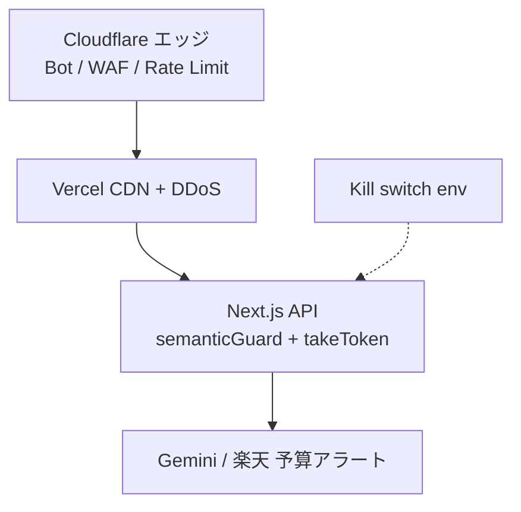

# Vercel 本番環境セットアップ（P0-6）

コード側の防護（レート制限・0004 RLS・CI）のあと、ダッシュボードで揃える項目。

## 1. Environment Variables

Vercel → Project → **Settings → Environment Variables**。

| 変数 | Production | Preview | 注意 |
| --- | --- | --- | --- |
| `NEXT_PUBLIC_SITE_URL` | 本番オリジン（末尾スラッシュ無し） | Preview は Vercel 既定で可 | sitemap / OG の canonical。独自ドメイン後は必ず更新 |
| `NEXT_PUBLIC_SUPABASE_URL` | 本番プロジェクト | 本番 or 別検証用 | `NEXT_PUBLIC_` のみブラウザに出る |
| `NEXT_PUBLIC_SUPABASE_ANON_KEY` | anon | anon | **service_role をここに置かない** |
| `SUPABASE_SERVICE_ROLE_KEY` | service_role | 必要なら | Server only。名前に `NEXT_PUBLIC_` を付けない |
| `EMBEDDING_PROVIDER` | `gemini` 等 | 同左 | DB の `embedding_model` と一致 |
| `GEMINI_API_KEY` | 本番鍵 | 同 or 別 | |
| `OPENAI_API_KEY` | 任意（控え） | 任意 | |
| `SEMANTIC_RECOMMEND_ENABLED` | `true` | `true` | 異常時は `false` で相談だけ止める |
| `SEMANTIC_RATE_LIMIT_PER_MIN` | `8`（目安） | 同左 | |
| `SEMANTIC_RATE_LIMIT_PER_DAY` | `80`（目安） | 同左 | |
| `NEXT_PUBLIC_GTM_ID` | `GTM-…`（任意） | 任意 | 未設定なら GTM スクリプトを出さない。GA4 は GTM 内で接続 |
| `ACCESS_LOG_ENABLED` | `true` | `true` | `false` で Supabase `access_events` 書き込みを止める |
| `OPS_DASHBOARD_SECRET` | 16 文字以上の乱数 | **置かない**（または別秘密） | 内部 `/ops` 观测台。未設定なら 404。`NEXT_PUBLIC_` 禁止。cookie のみブラウザへ |
| `RAKUTEN_APPLICATION_ID` | 楽天アプリ ID | 同左 | Item Search 用。未設定ならキーワード検索にフォールバック |
| `RAKUTEN_ACCESS_KEY` | 楽天 accessKey | 同左 | **Server only**。2026-07-01 API 必須 |
| `RAKUTEN_AFFILIATE_ID` | アフィリエイト ID | 同左 | API 応答の `affiliateUrl` 用。未設定なら `NEXT_PUBLIC_` 側を使う |
| `NEXT_PUBLIC_RAKUTEN_AFFILIATE_ID` | アフィリエイト ID | **置かない** | リンクに出る公開情報。未登録 Preview への掲載はガイドライン違反になりうる。Production のみ `rakutenAffiliateWrapEnabled` が包む |
| `NEXT_PUBLIC_AMAZON_ASSOCIATE_TAG` | Amazon アソシエイト tag | 同左 | 検索 URL の `tag=`。未設定なら tag なし |
| `YAHOO_CLIENT_ID` | Yahoo ショッピング appid | 同左 | **Server only**。未設定なら検索 URL |
| `YAHOO_VC_SID` / `YAHOO_VC_PID` | ValueCommerce | **置かない** | 広告主提携承認後。Preview に置くと第14条（登録メディア以外への掲載）に抵触しうる |
| `SATOFULL_SEARCH_BASE_URL` | さとふる検索ベース | 同左 | 未設定時は公式 list.php |
| `SATOFULL_VC_SID` / `SATOFULL_VC_PID` | ValueCommerce MyLink | **置かない** | Yahoo と別 PID。Preview 禁止は同上 |
| `VALUE_COMMERCE_WRAP` | 省略可（Production は自動 on） | `0` または未設定 | `1` は登録済み URL での手動テスト専用 |

変更後は **Redeploy** する。

### 1.1 内部观测台 `/ops`

1. Production に `OPS_DASHBOARD_SECRET`（16〜256 文字の乱数）を入れる。Preview には置かないか**別秘密**にする  
2. Redeploy 後 `https://komesomme.jp/ops/login` で密钥登录（未設定時は 404，不宣传该路径）  
3. 看板只读 `access_events`（service_role）。anon SELECT 依然不可。Yahoo 短鎖表 `yahoo_shopping_affiliate_links` も anon 不可（0006）  
4. 公开导航・sitemap 不出。`robots.txt` Disallow `/ops`。响应 `Cache-Control: private, no-store`  
5. 密钥禁止 `NEXT_PUBLIC_`。浏览器只持有 12h HttpOnly 签名 cookie。门禁在 Node（layout / Route Handler），不依赖 Edge middleware  

## 2. 分離の目安

- **Production**: 本番 Supabase + 本番 AI 鍵  
- **Preview**: できれば別 Supabase、または同じでも相談上限を厳しく  

## 3. デプロイ後の確認（2 分）

1. 本番 URL で地図が出る  
2. 相談が Top 4 を返す  
3. DevTools → Network → 任意 HTML の Response Headers に  
   `X-Frame-Options: SAMEORIGIN`、`X-Content-Type-Options: nosniff` がある  
4. クライアント JS や Network に `service_role` 文字列が **無い**
5. `/sitemap.xml` と `/robots.txt` が開ける
6. 詳細手順は [smoke-test.md](./smoke-test.md)

## 4. ロールバック

Vercel → **Deployments** → 直前の Successful を **⋯ → Promote to Production**（または Redeploy 旧デプロイ）。

相談だけ止めたいとき: `SEMANTIC_RECOMMEND_ENABLED=false` → Redeploy（地図は生きたまま）。

## 5. 独自ドメイン（P0-6d）

Domains で追加 → DNS 指示どおり → HTTPS 自動。証明書エラーが消えたら Done。

### 5.1 ドメイン役割（2026-08 確定）

| ドメイン | 役割 | DNS / リダイレクト |
| --- | --- | --- |
| **komesomme.jp** | 旗舰・SEO・canonical の正本 | Vercel Production に A / CNAME。`NEXT_PUBLIC_SITE_URL=https://komesomme.jp` |
| **komesomme.com** | 防御・補助 | Cloudflare **301 → `https://komesomme.jp/`**（GSC プロパティは .jp のみで可） |
| **sommeatlas.com** | 将来の Somme Atlas 母站 Portal | 短期 **301 → `https://komesomme.jp/`**。矩阵 2〜3 製品後に Portal 化 |

`.jp` は Cloudflare 非対応のため日本のレジストラで取得。`.com` / `sommeatlas.com` は Cloudflare Registrar + DNS。

**www:** apex が正本。`www.komesomme.jp` を使う場合は Vercel に `www` を追加し、apex ↔ www の一方へ 301 を揃える（未設定なら apex のみで可）。

### 5.2 接続確認（2026-08-30 実測）

| URL | 結果 |
| --- | --- |
| `https://komesomme.jp` | **200** — 地図・相談 UI 表示 |
| `https://komesomme.com` | **301** → `https://komesomme.jp/` |
| `https://sommeatlas.com` | **301** → `https://komesomme.jp/` |
| `https://komesomme.jp/robots.txt` | **200** — `Sitemap: https://komesomme.jp/sitemap.xml` |
| `https://komesomme.jp/sitemap.xml` | **200** — トップ・銘柄・ライブラリ URL |

### 5.3 フッター（Somme Atlas）

品鑑 / ライブラリ / 法務ページの `SiteFooter` に **Somme Atlas プロジェクト**（`https://sommeatlas.com`）を 1 行。ホームは Desktop 100dvh のためフル footer なし（頂栏の法務リンクのみ）。

運営責任者 **Takae** は `/tokushoho` に記載。製品 UI に開発者名は載せない。

### 5.4 Google Search Console と検索表示

**新規ドメインは登録直後に Google 検索へ出ないのが普通**（数日〜数週間）。以下を済ませればインデックスは進む。

#### 必須（GSC）

1. **プロパティ**は **`https://komesomme.jp`**（ドメインプレフィックスまたは URL プレフィックス）。`.com` / `sommeatlas.com` は 301 のみなので **別プロパティ不要**。
2. **サイトマップ送信:** `https://komesomme.jp/sitemap.xml`  
   - GSC → サイトマップ → 新規送信に `sitemap.xml`
3. **URL 検査:** トップ `/` で「インデックス登録をリクエスト」（ホーム 1 回 + 重要ページ数本）
4. **所有権確認**が Valid であること（HTML タグ / DNS TXT 等）

#### コード側（本番 env 済みなら OK）

- `NEXT_PUBLIC_SITE_URL=https://komesomme.jp` → `robots.txt` / `sitemap.xml` / OG の URL が `.jp` になる
- `robots.txt` は `Allow: /`（`/api/` のみ Disallow）
- `sitemap.xml` に `/`、`/library`、事典 `/library/[id]` を含める（旧 `/{id}` はリダイレクトのみ）

#### 待ち時間の目安

| 段階 | 目安 |
| --- | --- |
| GSC に URL が「クロール済み」 | 数時間〜2 日 |
| 「インデックス登録済み」 | 2 日〜2 週間 |
| `site:komesomme.jp` でヒット | インデックス後 |
| ブランド名「KomeSomme」で上位 | 被リンク・更新頻度が必要（数週間〜） |

#### まだ出ないときの確認

- GSC → **ページ** → 未登録理由（`Crawled - currently not indexed` は新站でありがち）
- `site:komesomme.jp` を Google 検索（ゼロ件なら未インデックス）
- 楽天等の **媒体 URL** が `https://komesomme.jp` と一致しているか（別ドメインのみだと評価が分散しないが、ユーザー導線は .jp に統一）

#### 任意（中〜長期）

- Google **Indexing API** は一般サイト向けではない（求めない）
- 被リンク 1 本（X / note / 個人ブログ）があると初回クロールが早まることがある
- **Google ビジネスプロフィール**は EC 自社販売ではないため不要

## 6. 本番切替チェックリスト（ドメイン取得後）

- [ ] Vercel Domains: `komesomme.jp`（+ 任意 `www`）
- [ ] Production env: `NEXT_PUBLIC_SITE_URL=https://komesomme.jp`
- [ ] Redeploy Production
- [ ] Cloudflare: `komesomme.jp` DNS 橙云 + §7.5（Bot Fight + 限速/WAF）
- [ ] Cloudflare: `komesomme.com` / `sommeatlas.com` → 301 `.jp`
- [ ] 楽天 / VC **媒体 URL** → `https://komesomme.jp`
- [ ] GSC プロパティ + `sitemap.xml` 送信 + トップのインデックスリクエスト
- [ ] [smoke-test.md](./smoke-test.md) 記録欄に URL・日付・結果

## 7. 乱暴接続・コスト攻撃への多層防御

**目的:** 静的ページの帯域洪水と、相談 API / 外部 API 呼び出しによる **課金爆発** を別々に潰す。

### 7.1 攻撃面と現状

| 経路 | コスト | 現状 |
| --- | --- | --- |
| `GET /`・銘柄・`/library/*`（SSG） | Vercel 帯域・関数起動（低） | アプリ側レート制限なし。Vercel 標準 DDoS + CDN |
| `POST /api/rice/semantic-recommend` | **Gemini + Supabase RPC（高）** | IP 8/min・80/day、`SEMANTIC_RECOMMEND_ENABLED` kill switch |
| `GET /api/rice/shop-links`・`rakuten-item` | 楽天 API | 40/min/IP。超過時は検索 URL フォールバック |
| `POST /api/analytics/event` | 低 | 60/min/IP |
| `/ops`・`/api/ops/*` | 低（読取） | 未設定は 404。設定時は署名 cookie。login 10/min/IP、summary 30/min/IP |
| 実装 | — | `src/lib/security/rateLimit.ts`（**isolate 内メモリ**。複数インスタンス間は非共有） |

`.jp` は Cloudflare **活动**（NS 変更済み想定）。以下 §7.5 でエッジ設定手順。

### 7.5 Cloudflare 設定手順（komesomme.jp）

**前提:** レジストラの NS が Cloudflare の 2 本になっていること。ダッシュボードで「活动」= OK。

#### Step 0 — DNS（最重要）

**域名 → komesomme.jp → DNS → 记录**

| 类型 | 名称 | 内容 | 代理 |
| --- | --- | --- | --- |
| `A` 或 `CNAME` | `@` | Vercel Domains 页指示（常见 `76.76.21.21` 或 `cname.vercel-dns.com`） | **橙色云朵 ON** |
| `CNAME` | `www`（若用） | `cname.vercel-dns.com` | **橙色 ON** |

灰色云朵 = 流量 bypass CF，防护无效。改完后 `https://komesomme.jp` 仍 200。

Vercel → Project → Settings → Domains：`komesomme.jp` 显示 **Valid**（或 **Proxy Detected** 黄标，见下）。

**Vercel「Proxy Detected」:** 橙云开启后 Domains 页会出现 *Using a proxy in front of Vercel…* 提示。**不是故障**，站点可正常 Production。Vercel 希望流量直打自家边缘以用其 DDoS/ bot 工具；本番 **故意** 用 CF 代理时忽略即可。

| 选项 | 适用 |
| --- | --- |
| **保持橙云（推荐）** | 要用 CF Bot Fight / WAF / 速率限制挡相談 API 与洪水 |
| **改回灰云（仅 DNS）** | 只信 Vercel 防护 + 应用层限流；CF 安全规则 **不生效** |

性能：多一跳 CF 边缘，对日本用户通常可忽略；SSG 页面 CF 可缓存（按需开「缓存规则」，默认动态/API 不缓存）。

#### Step 1 — SSL/TLS

**SSL/TLS → 概述**

- 加密模式: **完全（严格）** / Full (strict)
- **边缘证书 → 始终使用 HTTPS**: ON
- **自动 HTTPS 重写**: ON

#### Step 2 — 免费层基础防护

**安全性 → 设置**

| 项 | 建议 |
| --- | --- |
| **Bot Fight Mode** | **ON**（免费；拦明显坏 bot） |
| **安全级别** | **中等**；被刷时临时改 **I'm Under Attack** |
| **浏览器完整性检查** | ON（正常浏览器访问 OK；相談 API 从浏览器 POST 不受影响） |

`.com` / `sommeatlas.com` 若只做 301，同样开 Bot Fight 即可，不必 duplicate 限速。

#### Step 3 — 速率限制（Pro 推荐；Free 用 WAF 替代）

**Pro 及以上:** **安全性 → WAF → 速率限制规则 → 创建规则**

**规则 1 — 相談 API（必做）**

- 名称: `Limit semantic-recommend POST`
- 匹配: `URI Path` equals `/api/rice/semantic-recommend` **AND** `Request Method` equals `POST`
- 速率: **10 请求 / 1 分钟 / IP**
- 操作: **阻止** 60 秒（或「托管质询」）

**规则 2 — 全 API POST**

- 匹配: `URI Path` starts with `/api/` **AND** `Request Method` equals `POST`
- 速率: **30 请求 / 1 分钟 / IP**
- 操作: 阻止 60 秒

**规则 3 — 全站洪水（可选）**

- 匹配: 所有入站请求
- 速率: **300 请求 / 1 分钟 / IP**
- 操作: 托管质询（避免误伤正常用户可略高或跳过日本 ASN）

**Free 计划（无速率限制产品）:** **安全性 → WAF → 自定义规则**（最多 5 条）

**不要用规则 A（相談 POST 全量托管质询）:** 2026-08 実測で、浏览器からの正常な `POST /api/rice/semantic-recommend` も JSON 以外（质询 HTML）が返り、UI が「うまく読み取れませんでした」になる。**禁用该规则后即恢复。** Free では相談路径に Managed Challenge を常時かけない。

**Free 推荐组合（实测可用）:**

| 层 | 设置 |
| --- | --- |
| 橙云 + Bot Fight | 已开 |
| **规则 B**（下） | 拦无 UA / 非 JSON 的脚本 POST |
| 应用层 | `semanticGuard` 8/min、80/day + kill switch |
| 被刷时 | 临时 Under Attack，或升 Pro 速率限制 |

**规则 B — 拦明显脚本（Free 主规则，保留）**

1. **安全性** → **WAF** → **自定义规则** → **创建规则**
2. **规则名称:** `Block bad semantic POST`
3. **表达式:**

```
(http.request.uri.path eq "/api/rice/semantic-recommend" and http.request.method eq "POST" and (len(http.user_agent) eq 0 or not http.request.headers["content-type"][0] contains "application/json"))
```

4. **则采取操作:** **阻止**（Block）
5. **部署**

仍不足时: 升 **Pro** 用速率限制（§7.5 Step 3 Pro 段），不要对相談 POST 再开全量托管质询。

#### Step 4 — 安全见解（截图中的「1 insight」）

**安全性 → 概述** 或 **Security Insights** → 点开 `.jp` 的建议项，按提示一键修复（常见: SSL 模式、缺少 HSTS、DNSSEC 等）。

#### Step 5 — 验证

```bash
# 站点仍通
curl -sI https://komesomme.jp | head -5
# 应见 cf-ray 头（说明走 CF）
curl -sI https://komesomme.jp | findstr /i cf-ray

# 相談超限（Pro 限速后）应 429/403；应用层亦 429
```

CF **安全性 → 事件** 可看到被拦请求。异常时: Vercel `SEMANTIC_RECOMMEND_ENABLED=false` → CF Under Attack。

#### Step 6 — 与 Vercel 应用限流的关系

| 层 | 阈值 | 说明 |
| --- | --- | --- |
| CF 规则 1 | 10/min | 略宽于应用 8/min，CF 先挡 |
| 应用 `semanticGuard` | 8/min, 80/day | isolate 内；CF 后仍保留 |
| Kill switch | env | 最后一道 |

`clientIp.ts` 已读 `cf-connecting-ip`，CF 代理后 IP 限流仍有效。




1. **エッジ（最優先・コード不要）**
   - **komesomme.jp を Cloudflare に載せる**（レジストラで NS を CF に変更。CF Registrar 不要）。Orange cloud プロキシ ON。
   - CF **Security → Settings**: Bot Fight Mode ON（無料）。
   - CF **WAF / Rate limiting rules**（有料プランまたは無料枠内）例:
     - `POST */api/rice/semantic-recommend` → 同一 IP **10 req/min**（アプリ 8/min より少し緩くて可）
     - `POST */api/*` → **30 req/min**
     - 全世界 → **300 req/min/IP**（静的 GET 洪水の足切り）
   - `.com` / `sommeatlas.com` は既に CF。301 前に CF が吸うので、攻撃者が `.com` を叩いても Vercel 負荷は小さい。

2. **アプリ（実装済み + 後続）**
   - 相談: 現行閾値のまま維持。本番 env で `SEMANTIC_RECOMMEND_ENABLED=false` を **1 クリック停止** 手順を覚える。
   - **Upstash Redis**（P0-1a 後続）: `@upstash/ratelimit` で **全リージョン共有** の IP 上限。トラフィックが isolate 限界を超えたら実装。
   - 任意: `middleware.ts` で `/api/*` 全体に粗い上限（例 120/min/IP）— CF と二重化。

3. **プロバイダ予算（必須・手動）**
   - **Google AI Studio / Cloud**: 日次・月次 **予算アラート + ハード cap**（Gemini embedding + chat）。
   - **楽天 API**: 利用上限・エラー率をダッシュボードで監視。
   - **Vercel**: Billing → **Spend Management** アラート（Unexpected traffic 検知）。

4. **観測**
   - Vercel **Analytics / Logs**: 429・503 急増、`/api/rice/semantic-recommend` の 5xx。
   - CF **Security Events**（.jp を CF 化後）。
   - 異常時: ① `SEMANTIC_RECOMMEND_ENABLED=false` Redeploy → ② CF で該当国/ASN チャallenge → ③ 閾値引き下げ。

### 7.3 何を心配しなくてよいか

- **ライブラリ 106 ページ + 地図 SSG**: ビルド済み HTML。通常のクロールやバズ程度では Vercel 無料〜Pro 帯で足りる。
- **shop-links レート超過**: 楽天を叩かず検索 URL を返す設計済み。

### 7.4 実装優先度（2026-08 時点）

| 優先 | 作業 | 工数 |
| --- | --- | --- |
| P0 | CF `.jp` DNS 橙云 + SSL 严格 + Bot Fight + 相談 POST 限速（Pro）或 WAF 质询（Free） | 运维 §7.5 |
| P0 | Gemini / Vercel 予算アラート設定 | 運用 30m |
| P1 | Upstash 全局限流（semantic + 任意 `/api/*`） | コード 半日 |
| P2 | Vercel Firewall（Pro）または CF 有料 WAF ルール拡張 | プラン次第 |

チェックリスト: [11-launch-checklist.md](./11-launch-checklist.md) **P0-1a / P0-1b**。

## 関連

- 相談防護: [03-system-design.md](./03-system-design.md) §4–5  
- RLS 実測: [rls-verify.md](./rls-verify.md)  
- 全体: [11-launch-checklist.md](./11-launch-checklist.md)
